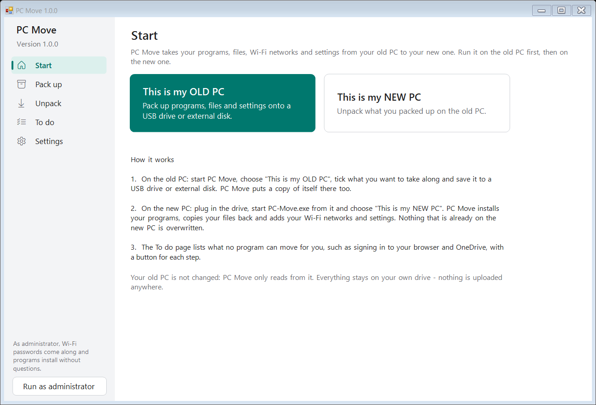
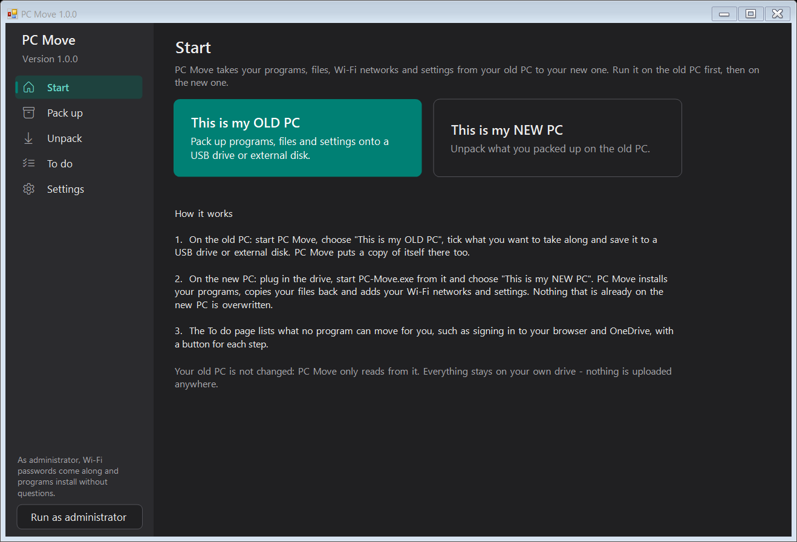

# PC Move

Move to a new Windows PC without forgetting anything. PC Move packs up your programs, files, Wi-Fi networks and settings on the old PC, and unpacks them on the new one. What no program can move for you becomes a short checklist.

Free, open source, one small file, no account, nothing uploaded. Windows 10 and 11. In English, Dutch, German, French, Spanish, Italian and Polish.

**[Download PC-Move.exe](https://github.com/michaelkloprogge-gif/pc-move/releases/latest/download/PC-Move.exe)**

|  |  |
|---|---|

## How it works

1. **On the old PC:** start PC-Move.exe and choose **This is my OLD PC**. Tick what you want to take along, choose a USB drive or external disk, and click **Pack up**. PC Move puts a copy of itself on the drive too.
2. **On the new PC:** plug in the drive and start PC-Move.exe from the move folder. It opens the folder by itself and shows what it can bring over. Click **Unpack**.
3. **To do:** the steps no program can do for you, each with a button that opens the right place. Tick them off as you go.

Your old PC is never changed: PC Move only reads from it.

## What moves

| | On the old PC | On the new PC |
|---|---|---|
| **Programs** | the list of installed programs that winget knows - including programs installed another way, looked up by name | installed again with winget (the newest version). Programs already there are skipped |
| **Files** | Desktop, Documents, Pictures, Music, Videos, Downloads, Favorites (folders already in OneDrive are left out - they come back when you sign in) | copied into the same folders on the new PC. **A file that is already there is never overwritten** |
| **Wi-Fi** | your saved networks, with passwords when PC Move runs as administrator | added. Networks the new PC already knows are skipped |
| **Settings** | light/dark mode, taskbar alignment and search box, file extensions, hidden files, where File Explorer opens, mouse speed, double-click speed | only the ones that differ are offered; **Settings > Undo** puts them back |
| **Desktop background** | your own picture | set as the background (and saved in Pictures) |
| **Bookmarks** | Chrome, Edge, Brave and Vivaldi, every profile | saved in Documents as a bookmarks file; the To do page opens the browser's import page |

**Not moved, on the To do page instead:** saved browser passwords (sign in to the browser), Firefox (sign in to Firefox), Microsoft 365, Steam games, programs winget doesn't know, your default browser, printers, and Windows Update.

Runtimes, drivers and the PC maker's own tools (Dell, HP, Lenovo...) are recognised and left unticked: the new PC has its own.

## Good to know

- **Wi-Fi passwords** are stored as plain text in the move folder (that is how Windows exports them). Keep the drive safe and delete the move folder when the move is done - the To do page reminds you.
- **Run as administrator** (button at the bottom left) on the old PC to include Wi-Fi passwords, and on the new PC so program installers don't each ask for permission.
- **winget** comes with Windows 11 and recent Windows 10 ("App Installer" in the Microsoft Store). Without it, programs go on the To do list instead.
- The move folder is plain files and folders: you can open it in File Explorer and take anything out by hand.
- What PC Move did is logged in `%LOCALAPPDATA%\PCMove\changes.log`.

## Privacy

Everything stays on your own PCs and drive. The only internet use is the update check (GitHub) and winget, which downloads the programs you move. Nothing about your PC is sent anywhere.

## Building

`.\build-exe.ps1` builds `dist\PC-Move.exe`: a small C# host with `pc-move.ps1` embedded, compiled with the C# compiler that ships with Windows - nothing to install. You can also run the script directly with `PC-Move.cmd`.

`.\build-msix.ps1` packs that exe as `dist\PC-Move.msix` for the Microsoft Store (needs the Windows SDK; the Store signs it). `-Register` installs the unpacked package on this PC to try it (Developer Mode). The Store copy leaves updates to the Store.

Tests: `.\tests\Test-Languages.ps1` (translation files) and `powershell -STA -File .\tests\Test-App.ps1 [-Language nl]` (a real move between two temporary folders, in a hidden window).

Release: bump `$AppVersion` in `pc-move.ps1`, then `.\publish-release.ps1 -Notes "..."`. GitHub Actions tests, builds and publishes it, and installed copies offer the update.

Made by the author of [PC Tune-Up](https://github.com/michaelkloprogge-gif/pc-tuneup). MIT licence.
